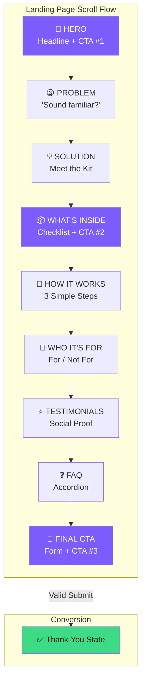

# 🏗️ Architecture — Content Creator Kit Landing Page

> Derived from [problemstatement.md](file:///c:/Users/Vaibhav%20Singh/Desktop/Landing_page_ss/problemstatement.md)

---

## 1. Overview

A **single-page, mobile-first** landing page with one goal: get the visitor to click **"Start My 7-Day Plan"** and submit their name + email. No framework overhead — plain HTML, vanilla CSS, and vanilla JavaScript.

```mermaid
flowchart LR
    A["Visitor Lands"] --> B["Hero — Curiosity"]
    B --> C["Problem — Relatability"]
    C --> D["Solution — Understanding"]
    D --> E["What's Inside — Value"]
    E --> F["How It Works — Clarity"]
    F --> G["Who It's For — Self-Qualification"]
    G --> H["Testimonials — Trust"]
    H --> I["FAQ — Remove Doubts"]
    I --> J["Final CTA — Action"]
    J --> K["Sign-Up Complete ✅"]
```



---

## 2. Tech Stack

| Layer | Choice | Rationale |
|---|---|---|
| **Structure** | HTML5 (semantic) | SEO-friendly, accessible, zero dependencies |
| **Styling** | Vanilla CSS (custom properties) | Full control, no build step, easy theming |
| **Logic** | Vanilla JavaScript (ES6+) | FAQ accordion, form validation, thank-you state |
| **Fonts** | Google Fonts — **Inter** | Modern, highly readable, free |
| **Icons** | Inline SVG or emoji | No icon-library dependency |
| **Hosting** | Static (any CDN / GitHub Pages / Netlify) | Instant deploy, no server needed |

> [!NOTE]
> No bundler, preprocessor, or framework is used. The entire page ships as 3 files (`index.html`, `style.css`, `script.js`) plus font and image assets.

---

## 3. File Structure

```
Landing_page_ss/
├── index.html              # Single-page markup (all 9 sections)
├── style.css               # Design system + component styles
├── script.js               # Accordion, form validation, scroll behavior
├── assets/
│   └── images/             # Hero visual, kit preview, testimonial avatars
├── problemstatement.txt    # Original brief (raw)
├── problemstatement.md     # Formatted brief
└── architecture.md         # This file
```

---

## 4. Section → Component Mapping

Each section from the problem statement maps to a semantic HTML landmark and a CSS component class.

| # | Section | HTML Element | CSS Class | Key Behavior |
|---|---|---|---|---|
| 1 | Hero | `<header id="hero">` | `.hero` | CTA button scrolls to / opens sign-up form |
| 2 | Problem | `<section id="problem">` | `.problem` | Fade-in on scroll |
| 3 | Solution | `<section id="solution">` | `.solution` | Static content |
| 4 | What's Inside | `<section id="whats-inside">` | `.whats-inside` | Checklist with mid-page CTA |
| 5 | How It Works | `<section id="how-it-works">` | `.how-it-works` | 3-step numbered cards |
| 6 | Who It's For | `<section id="who-its-for">` | `.who-its-for` | Two-column For / Not For |
| 7 | Testimonials | `<section id="testimonials">` | `.testimonials` | Card grid (placeholder-ready) |
| 8 | FAQ | `<section id="faq">` | `.faq` | JS-powered accordion |
| 9 | Final CTA | `<section id="final-cta">` | `.final-cta` | Inline sign-up form |

---

## 5. Design System

### 5.1 Color Palette

```css
:root {
  /* Core */
  --color-bg:          #0F0F14;        /* Deep dark background       */
  --color-surface:     #1A1A24;        /* Card / section surface      */
  --color-surface-alt: #24243A;        /* Elevated surface            */

  /* Accent — single CTA color */
  --color-accent:      #7C5CFC;        /* Vibrant purple              */
  --color-accent-hover:#9B80FF;        /* Lighter on hover            */
  --color-accent-glow: rgba(124,92,252,0.35); /* Button glow shadow  */

  /* Text */
  --color-text:        #EAEAF0;        /* Primary text                */
  --color-text-muted:  #9494A8;        /* Secondary / microcopy       */
  --color-text-invert: #0F0F14;        /* Text on accent buttons      */

  /* Utility */
  --color-border:      #2E2E42;        /* Subtle borders              */
  --color-success:     #3DDC84;        /* Form success state          */
  --color-error:       #FF5C5C;        /* Form error state            */
}
```

### 5.2 Typography

```css
:root {
  --font-family:    'Inter', system-ui, -apple-system, sans-serif;
  --fs-hero:        clamp(2.25rem, 5vw, 3.75rem);   /* Hero headline  */
  --fs-h2:          clamp(1.5rem, 3.5vw, 2.5rem);    /* Section heads  */
  --fs-h3:          clamp(1.125rem, 2.5vw, 1.5rem);  /* Sub-heads      */
  --fs-body:        1rem;                              /* 16px base      */
  --fs-small:       0.875rem;                          /* Microcopy      */
  --line-height:    1.6;
  --font-weight-regular: 400;
  --font-weight-medium:  500;
  --font-weight-bold:    700;
}
```

### 5.3 Spacing & Layout

```css
:root {
  --space-xs:  0.5rem;    /*  8px */
  --space-sm:  1rem;      /* 16px */
  --space-md:  1.5rem;    /* 24px */
  --space-lg:  3rem;      /* 48px */
  --space-xl:  5rem;      /* 80px */
  --max-width: 720px;     /* Content column */
  --radius-sm: 8px;
  --radius-md: 12px;
  --radius-lg: 20px;
}
```

### 5.4 Shadows & Effects

```css
:root {
  --shadow-card: 0 4px 24px rgba(0,0,0,0.25);
  --shadow-glow: 0 0 30px var(--color-accent-glow);
  --transition-base: 0.25s cubic-bezier(0.4, 0, 0.2, 1);
}
```

---

## 6. Component Architecture

### 6.1 CTA Button (Reused 3×)

```
┌─────────────────────────────────┐
│  Start My 7-Day Plan            │  ← .btn-primary
├─────────────────────────────────┤
│  Free to start. No credit card  │  ← .microcopy
│  needed.                        │
└─────────────────────────────────┘
```

- Single accent color, pill shape (`border-radius: var(--radius-lg)`)
- Glow shadow on hover (`--shadow-glow`)
- Scale transform on hover (`transform: scale(1.03)`)
- Appears in **Hero**, **What's Inside**, and **Final CTA**

### 6.2 FAQ Accordion

```
┌─ Question ──────────────────── ▼ ─┐
│                                    │  ← collapsed (default)
└────────────────────────────────────┘

┌─ Question ──────────────────── ▲ ─┐
│  Answer text displayed here.       │  ← expanded
│                                    │
└────────────────────────────────────┘
```

- Pure JS toggle (no library)
- `aria-expanded`, `aria-controls` for accessibility
- Smooth `max-height` transition

### 6.3 Sign-Up Form

```
┌────────────────────────────────────┐
│  Name      [ _____________________ ] │
│  Email     [ _____________________ ] │
│  [ Start My 7-Day Plan ]            │
│  Free to start. Takes < a minute.   │
└────────────────────────────────────┘
           ↓ on success ↓
┌────────────────────────────────────┐
│  ✅ You're in! Check your inbox.   │
└────────────────────────────────────┘
```

- Front-end validation only (required, email format)
- Inline error messages with `--color-error`
- On valid submit → hide form, show thank-you state with `--color-success`
- No backend; real submission endpoint can be wired later

---

## 7. Responsive Strategy

| Breakpoint | Target | Key Adjustments |
|---|---|---|
| **< 480px** | Small phones | Single column, stacked cards, `--fs-hero` at `clamp` minimum |
| **480–768px** | Large phones / small tablets | Slight padding increase, FAQ wider |
| **768–1024px** | Tablets | Two-column "Who It's For", side-by-side testimonial cards |
| **> 1024px** | Desktop | Centered `--max-width: 720px` column, generous whitespace |

**Approach:** Mobile-first CSS — base styles are mobile, `@media (min-width: ...)` adds desktop enhancements.

---

## 8. Interaction & Animation Spec

| Element | Trigger | Animation |
|---|---|---|
| CTA button | Hover | Scale 1.03 + glow shadow, `0.25s ease` |
| CTA button | Click | Brief scale 0.97 "press" |
| Section content | Scroll into view | Fade-up (`opacity 0→1, translateY 20px→0`), `0.5s ease-out` |
| FAQ item | Click | `max-height` expand/collapse, chevron rotate 180° |
| Form submit | Valid submit | Form fades out, thank-you card fades in |
| Form field | Invalid blur | Red border + inline error text shake |
| Checklist items | Scroll into view | Staggered fade-in (50ms delay each) |

> [!TIP]
> All animations respect `prefers-reduced-motion: reduce` — when set, transitions are instant (duration → `0.01s`).

---

## 9. SEO & Meta

```html
<head>
  <meta charset="UTF-8">
  <meta name="viewport" content="width=device-width, initial-scale=1.0">
  <title>Content Creator Kit — Make Your First 3 Reels in 7 Days</title>
  <meta name="description" content="A free 7-day plan to create your first 3 Instagram Reels using just your phone. No experience, no gear, no editing skills needed. Start today.">
  <meta name="keywords" content="Instagram Reels, content creator, beginner Reels, 7-day plan, Reel ideas, content kit">

  <!-- Open Graph -->
  <meta property="og:title" content="Make Your First 3 Reels in 7 Days">
  <meta property="og:description" content="A beginner-friendly 7-day plan. Just your phone and 30 minutes a day.">
  <meta property="og:type" content="website">
  <meta property="og:image" content="assets/images/og-preview.png">

  <!-- Fonts -->
  <link rel="preconnect" href="https://fonts.googleapis.com">
  <link rel="preconnect" href="https://fonts.gstatic.com" crossorigin>
  <link href="https://fonts.googleapis.com/css2?family=Inter:wght@400;500;700&display=swap" rel="stylesheet">
</head>
```

---

## 10. Accessibility Checklist

| Requirement | Implementation |
|---|---|
| Keyboard navigation | All interactive elements focusable, visible focus ring |
| Screen reader support | Semantic HTML, ARIA labels on form fields, `aria-expanded` on FAQ |
| Color contrast | All text meets **WCAG AA** (≥ 4.5:1 body, ≥ 3:1 large text) |
| Reduced motion | `@media (prefers-reduced-motion: reduce)` disables animations |
| Form errors | Announced via `aria-live="polite"` region |
| Heading hierarchy | Single `<h1>` (hero headline), sequential `<h2>`/`<h3>` |
| Alt text | All images have descriptive `alt` attributes |

---

## 11. Performance Budget

| Metric | Target |
|---|---|
| **Total page weight** | < 500 KB (excluding fonts) |
| **First Contentful Paint** | < 1.5s |
| **Largest Contentful Paint** | < 2.5s |
| **Cumulative Layout Shift** | < 0.1 |
| **JavaScript** | < 5 KB (minified) |
| **CSS** | < 15 KB |
| **Images** | WebP, lazy-loaded below fold |

---

## 12. Funnel Flow Diagram



---

## 13. JavaScript Module Map

```
script.js
├── initAccordion()         # FAQ expand/collapse with ARIA
├── initFormValidation()    # Name + email validation, error display
├── initFormSubmission()    # Swap form → thank-you state
├── initScrollAnimations()  # IntersectionObserver fade-in
└── initSmoothScroll()      # CTA buttons → target section scroll
```

> [!NOTE]
> All functions are vanilla JS — no jQuery, no libraries. Wrapped in a single `DOMContentLoaded` listener.

---

## 14. Build Checklist

- [ ] Set up file structure (`index.html`, `style.css`, `script.js`, `assets/`)
- [ ] Define CSS custom properties (design tokens from Section 5)
- [ ] Build **Hero** section with headline, subheadline, CTA #1
- [ ] Build **Problem** section with pain-point bullets
- [ ] Build **Solution** section with kit introduction
- [ ] Build **What's Inside** section with checklist + CTA #2
- [ ] Build **How It Works** section with 3-step cards
- [ ] Build **Who It's For** section with two-column layout
- [ ] Build **Testimonials** section with placeholder cards
- [ ] Build **FAQ** accordion with JS toggle
- [ ] Build **Final CTA** section with inline sign-up form + CTA #3
- [ ] Implement form validation (front-end, name + email)
- [ ] Implement thank-you state on valid submission
- [ ] Add scroll-triggered fade-in animations
- [ ] Add `prefers-reduced-motion` support
- [ ] Test responsive across breakpoints (320px → 1440px)
- [ ] Validate HTML (W3C), check accessibility (axe / Lighthouse)
- [ ] Optimize images (WebP, lazy loading)
- [ ] Run Lighthouse audit — target 90+ all categories
