# ⚡ Implementation Guide — Content Creator Kit Landing Page

> Derived from [architecture.md](file:///c:/Users/Vaibhav%20Singh/Desktop/Landing_page_ss/architecture.md) · Copy from [problemstatement.md](file:///c:/Users/Vaibhav%20Singh/Desktop/Landing_page_ss/problemstatement.md)

---

## Table of Contents

1. [Prerequisites & Setup](#1-prerequisites--setup)
2. [Phase 1 — Foundation (`style.css`)](#2-phase-1--foundation-stylecss)
3. [Phase 2 — Markup (`index.html`)](#3-phase-2--markup-indexhtml)
4. [Phase 3 — Interactivity (`script.js`)](#4-phase-3--interactivity-scriptjs)
5. [Phase 4 — Responsive Polish](#5-phase-4--responsive-polish)
6. [Phase 5 — Animations & Micro-Interactions](#6-phase-5--animations--micro-interactions)
7. [Phase 6 — Accessibility Hardening](#7-phase-6--accessibility-hardening)
8. [Phase 7 — Testing & QA](#8-phase-7--testing--qa)
9. [Asset Checklist](#9-asset-checklist)
10. [Deployment](#10-deployment)

---

## 1. Prerequisites & Setup

### 1.1 Create the File Structure

```
Landing_page_ss/
├── index.html
├── style.css
├── script.js
└── assets/
    └── images/
        ├── hero-visual.webp
        ├── kit-preview.webp
        ├── avatar-1.webp
        ├── avatar-2.webp
        ├── avatar-3.webp
        └── og-preview.png
```

### 1.2 Google Font

Load **Inter** (weights 400, 500, 700) via `<link>` in the `<head>`. No self-hosting needed for v1.

### 1.3 Development Server

Use any static file server for local development:

```bash
# Option A — VS Code Live Server extension (recommended)
# Option B — Python
python -m http.server 3000

# Option C — Node
npx -y serve .
```

---

## 2. Phase 1 — Foundation (`style.css`)

> Build the design system **first**. Every component built later will reference these tokens.

### 2.1 Reset & Base

```css
/* ═══════════════════════════════════════════════════════
   RESET & BASE
   ═══════════════════════════════════════════════════════ */
*,
*::before,
*::after {
  margin: 0;
  padding: 0;
  box-sizing: border-box;
}

html {
  scroll-behavior: smooth;
  -webkit-text-size-adjust: 100%;
}

body {
  font-family: var(--font-family);
  font-size: var(--fs-body);
  font-weight: var(--font-weight-regular);
  line-height: var(--line-height);
  color: var(--color-text);
  background-color: var(--color-bg);
  overflow-x: hidden;
  -webkit-font-smoothing: antialiased;
  -moz-osx-font-smoothing: grayscale;
}

img {
  max-width: 100%;
  height: auto;
  display: block;
}

a {
  color: var(--color-accent);
  text-decoration: none;
}

ul, ol {
  list-style: none;
}
```

### 2.2 Design Tokens (CSS Custom Properties)

Paste the full token set from [architecture.md § 5](file:///c:/Users/Vaibhav%20Singh/Desktop/Landing_page_ss/architecture.md):

```css
/* ═══════════════════════════════════════════════════════
   DESIGN TOKENS
   ═══════════════════════════════════════════════════════ */
:root {
  /* ── Colors ────────────────────────────────────────── */
  --color-bg:           #0F0F14;
  --color-surface:      #1A1A24;
  --color-surface-alt:  #24243A;
  --color-accent:       #7C5CFC;
  --color-accent-hover: #9B80FF;
  --color-accent-glow:  rgba(124, 92, 252, 0.35);
  --color-text:         #EAEAF0;
  --color-text-muted:   #9494A8;
  --color-text-invert:  #0F0F14;
  --color-border:       #2E2E42;
  --color-success:      #3DDC84;
  --color-error:        #FF5C5C;

  /* ── Typography ────────────────────────────────────── */
  --font-family:         'Inter', system-ui, -apple-system, sans-serif;
  --fs-hero:             clamp(2.25rem, 5vw, 3.75rem);
  --fs-h2:               clamp(1.5rem, 3.5vw, 2.5rem);
  --fs-h3:               clamp(1.125rem, 2.5vw, 1.5rem);
  --fs-body:             1rem;
  --fs-small:            0.875rem;
  --line-height:         1.6;
  --font-weight-regular: 400;
  --font-weight-medium:  500;
  --font-weight-bold:    700;

  /* ── Spacing ───────────────────────────────────────── */
  --space-xs:  0.5rem;
  --space-sm:  1rem;
  --space-md:  1.5rem;
  --space-lg:  3rem;
  --space-xl:  5rem;
  --max-width: 720px;

  /* ── Borders & Radius ──────────────────────────────── */
  --radius-sm: 8px;
  --radius-md: 12px;
  --radius-lg: 20px;

  /* ── Shadows & Transitions ─────────────────────────── */
  --shadow-card:     0 4px 24px rgba(0, 0, 0, 0.25);
  --shadow-glow:     0 0 30px var(--color-accent-glow);
  --transition-base: 0.25s cubic-bezier(0.4, 0, 0.2, 1);
}
```

### 2.3 Utility Classes

```css
/* ═══════════════════════════════════════════════════════
   UTILITIES
   ═══════════════════════════════════════════════════════ */
.container {
  width: 100%;
  max-width: var(--max-width);
  margin-inline: auto;
  padding-inline: var(--space-md);
}

.section {
  padding-block: var(--space-xl);
}

.section__title {
  font-size: var(--fs-h2);
  font-weight: var(--font-weight-bold);
  margin-bottom: var(--space-md);
  text-align: center;
}

.text-muted {
  color: var(--color-text-muted);
  font-size: var(--fs-small);
}

.text-center {
  text-align: center;
}

.visually-hidden {
  position: absolute;
  width: 1px;
  height: 1px;
  padding: 0;
  margin: -1px;
  overflow: hidden;
  clip: rect(0, 0, 0, 0);
  white-space: nowrap;
  border: 0;
}
```

### 2.4 Component: CTA Button

```css
/* ═══════════════════════════════════════════════════════
   CTA BUTTON (reused 3×: hero, whats-inside, final-cta)
   ═══════════════════════════════════════════════════════ */
.btn-primary {
  display: inline-flex;
  align-items: center;
  justify-content: center;
  padding: 1rem 2.5rem;
  font-family: var(--font-family);
  font-size: var(--fs-body);
  font-weight: var(--font-weight-bold);
  color: var(--color-text-invert);
  background: var(--color-accent);
  border: none;
  border-radius: var(--radius-lg);
  cursor: pointer;
  transition:
    transform var(--transition-base),
    box-shadow var(--transition-base),
    background-color var(--transition-base);
  text-decoration: none;
  letter-spacing: 0.01em;
}

.btn-primary:hover,
.btn-primary:focus-visible {
  background: var(--color-accent-hover);
  transform: scale(1.03);
  box-shadow: var(--shadow-glow);
}

.btn-primary:active {
  transform: scale(0.97);
}

.microcopy {
  display: block;
  margin-top: var(--space-xs);
  color: var(--color-text-muted);
  font-size: var(--fs-small);
  text-align: center;
}
```

### 2.5 Component: Section Styles

```css
/* ═══════════════════════════════════════════════════════
   SECTION 1 — HERO
   ═══════════════════════════════════════════════════════ */
.hero {
  min-height: 100vh;
  min-height: 100dvh;
  display: flex;
  align-items: center;
  justify-content: center;
  text-align: center;
  padding-block: var(--space-xl);
  position: relative;
  overflow: hidden;
}

.hero::before {
  content: '';
  position: absolute;
  width: 500px;
  height: 500px;
  background: radial-gradient(circle, var(--color-accent-glow), transparent 70%);
  top: -150px;
  right: -150px;
  pointer-events: none;
  z-index: 0;
}

.hero__content {
  position: relative;
  z-index: 1;
}

.hero__headline {
  font-size: var(--fs-hero);
  font-weight: var(--font-weight-bold);
  line-height: 1.15;
  margin-bottom: var(--space-sm);
  background: linear-gradient(135deg, var(--color-text) 0%, var(--color-accent-hover) 100%);
  -webkit-background-clip: text;
  -webkit-text-fill-color: transparent;
  background-clip: text;
}

.hero__subheadline {
  font-size: var(--fs-h3);
  font-weight: var(--font-weight-regular);
  color: var(--color-text-muted);
  max-width: 540px;
  margin-inline: auto;
  margin-bottom: var(--space-lg);
}


/* ═══════════════════════════════════════════════════════
   SECTION 2 — PROBLEM
   ═══════════════════════════════════════════════════════ */
.problem {
  background-color: var(--color-surface);
}

.problem__list {
  max-width: 540px;
  margin-inline: auto;
  margin-bottom: var(--space-md);
}

.problem__list li {
  position: relative;
  padding-left: var(--space-md);
  margin-bottom: var(--space-sm);
  color: var(--color-text-muted);
  font-size: 1.05rem;
}

.problem__list li::before {
  content: '😩';
  position: absolute;
  left: 0;
}

.problem__closer {
  text-align: center;
  font-size: var(--fs-h3);
  font-weight: var(--font-weight-medium);
  font-style: italic;
  color: var(--color-text);
}


/* ═══════════════════════════════════════════════════════
   SECTION 3 — SOLUTION
   ═══════════════════════════════════════════════════════ */
.solution {
  text-align: center;
}

.solution__text {
  max-width: 540px;
  margin-inline: auto;
  font-size: 1.05rem;
  color: var(--color-text-muted);
}

.solution__text strong {
  color: var(--color-accent-hover);
}


/* ═══════════════════════════════════════════════════════
   SECTION 4 — WHAT'S INSIDE
   ═══════════════════════════════════════════════════════ */
.whats-inside {
  background-color: var(--color-surface);
}

.whats-inside__list {
  max-width: 540px;
  margin-inline: auto;
  margin-bottom: var(--space-lg);
}

.whats-inside__list li {
  display: flex;
  align-items: flex-start;
  gap: var(--space-xs);
  padding: var(--space-xs) 0;
  font-size: 1.05rem;
  border-bottom: 1px solid var(--color-border);
}

.whats-inside__list li:last-child {
  border-bottom: none;
}

.whats-inside__check {
  color: var(--color-success);
  font-size: 1.25rem;
  flex-shrink: 0;
}


/* ═══════════════════════════════════════════════════════
   SECTION 5 — HOW IT WORKS
   ═══════════════════════════════════════════════════════ */
.how-it-works__steps {
  display: grid;
  grid-template-columns: 1fr;
  gap: var(--space-md);
  max-width: 540px;
  margin-inline: auto;
}

.step-card {
  background: var(--color-surface);
  border: 1px solid var(--color-border);
  border-radius: var(--radius-md);
  padding: var(--space-md);
  text-align: center;
  transition: transform var(--transition-base), box-shadow var(--transition-base);
}

.step-card:hover {
  transform: translateY(-4px);
  box-shadow: var(--shadow-card);
}

.step-card__number {
  display: inline-flex;
  align-items: center;
  justify-content: center;
  width: 48px;
  height: 48px;
  background: var(--color-accent);
  color: var(--color-text-invert);
  font-weight: var(--font-weight-bold);
  font-size: 1.25rem;
  border-radius: 50%;
  margin-bottom: var(--space-sm);
}

.step-card__text {
  color: var(--color-text-muted);
}


/* ═══════════════════════════════════════════════════════
   SECTION 6 — WHO IT'S FOR
   ═══════════════════════════════════════════════════════ */
.who-its-for__grid {
  display: grid;
  grid-template-columns: 1fr;
  gap: var(--space-md);
  max-width: 600px;
  margin-inline: auto;
}

.who-card {
  background: var(--color-surface);
  border-radius: var(--radius-md);
  padding: var(--space-md);
  border: 1px solid var(--color-border);
}

.who-card__title {
  font-size: var(--fs-h3);
  font-weight: var(--font-weight-bold);
  margin-bottom: var(--space-sm);
}

.who-card--for .who-card__title {
  color: var(--color-success);
}

.who-card--not .who-card__title {
  color: var(--color-error);
}

.who-card li {
  padding: var(--space-xs) 0;
  color: var(--color-text-muted);
}


/* ═══════════════════════════════════════════════════════
   SECTION 7 — TESTIMONIALS
   ═══════════════════════════════════════════════════════ */
.testimonials {
  background-color: var(--color-surface);
}

.testimonials__grid {
  display: grid;
  grid-template-columns: 1fr;
  gap: var(--space-md);
  max-width: 600px;
  margin-inline: auto;
}

.testimonial-card {
  background: var(--color-surface-alt);
  border-radius: var(--radius-md);
  padding: var(--space-md);
  border: 1px solid var(--color-border);
}

.testimonial-card__quote {
  font-style: italic;
  margin-bottom: var(--space-sm);
  line-height: 1.7;
  color: var(--color-text);
}

.testimonial-card__author {
  display: flex;
  align-items: center;
  gap: var(--space-xs);
}

.testimonial-card__avatar {
  width: 40px;
  height: 40px;
  border-radius: 50%;
  background: var(--color-border);
  object-fit: cover;
}

.testimonial-card__name {
  font-weight: var(--font-weight-medium);
  font-size: var(--fs-small);
}

.testimonial-card__role {
  font-size: var(--fs-small);
  color: var(--color-text-muted);
}


/* ═══════════════════════════════════════════════════════
   SECTION 8 — FAQ (ACCORDION)
   ═══════════════════════════════════════════════════════ */
.faq__list {
  max-width: 600px;
  margin-inline: auto;
}

.faq-item {
  border-bottom: 1px solid var(--color-border);
}

.faq-item__question {
  width: 100%;
  display: flex;
  align-items: center;
  justify-content: space-between;
  padding: var(--space-sm) 0;
  background: none;
  border: none;
  color: var(--color-text);
  font-family: var(--font-family);
  font-size: var(--fs-body);
  font-weight: var(--font-weight-medium);
  cursor: pointer;
  text-align: left;
  transition: color var(--transition-base);
}

.faq-item__question:hover {
  color: var(--color-accent-hover);
}

.faq-item__icon {
  flex-shrink: 0;
  width: 20px;
  height: 20px;
  transition: transform var(--transition-base);
  color: var(--color-text-muted);
}

.faq-item[data-open="true"] .faq-item__icon {
  transform: rotate(180deg);
}

.faq-item__answer {
  max-height: 0;
  overflow: hidden;
  transition: max-height 0.35s ease, padding 0.35s ease;
}

.faq-item[data-open="true"] .faq-item__answer {
  max-height: 200px;  /* adjust if answers are longer */
}

.faq-item__answer p {
  padding-bottom: var(--space-sm);
  color: var(--color-text-muted);
  font-size: var(--fs-body);
}


/* ═══════════════════════════════════════════════════════
   SECTION 9 — FINAL CTA + FORM
   ═══════════════════════════════════════════════════════ */
.final-cta {
  background: linear-gradient(
    180deg,
    var(--color-bg) 0%,
    var(--color-surface) 100%
  );
  text-align: center;
}

.final-cta__text {
  color: var(--color-text-muted);
  max-width: 480px;
  margin-inline: auto;
  margin-bottom: var(--space-lg);
}

/* Sign-up form */
.signup-form {
  max-width: 400px;
  margin-inline: auto;
  display: flex;
  flex-direction: column;
  gap: var(--space-sm);
}

.form-field {
  display: flex;
  flex-direction: column;
  gap: 4px;
}

.form-field label {
  font-size: var(--fs-small);
  font-weight: var(--font-weight-medium);
  color: var(--color-text-muted);
}

.form-field input {
  padding: 0.85rem var(--space-sm);
  background: var(--color-surface-alt);
  border: 1px solid var(--color-border);
  border-radius: var(--radius-sm);
  color: var(--color-text);
  font-family: var(--font-family);
  font-size: var(--fs-body);
  transition:
    border-color var(--transition-base),
    box-shadow var(--transition-base);
}

.form-field input:focus {
  outline: none;
  border-color: var(--color-accent);
  box-shadow: 0 0 0 3px var(--color-accent-glow);
}

.form-field input.input--error {
  border-color: var(--color-error);
  box-shadow: 0 0 0 3px rgba(255, 92, 92, 0.2);
}

.form-field__error {
  font-size: var(--fs-small);
  color: var(--color-error);
  min-height: 1.25em;
}

/* Thank-you state */
.thank-you {
  display: none;
  text-align: center;
  padding: var(--space-lg) var(--space-md);
  animation: fadeIn 0.5s ease forwards;
}

.thank-you.is-visible {
  display: block;
}

.thank-you__icon {
  font-size: 3rem;
  margin-bottom: var(--space-sm);
}

.thank-you__heading {
  font-size: var(--fs-h2);
  font-weight: var(--font-weight-bold);
  margin-bottom: var(--space-xs);
  color: var(--color-success);
}

.thank-you__text {
  color: var(--color-text-muted);
}
```

---

## 3. Phase 2 — Markup (`index.html`)

> [!IMPORTANT]
> All copy below is taken **verbatim** from [problemstatement.md § 3](file:///c:/Users/Vaibhav%20Singh/Desktop/Landing_page_ss/problemstatement.md). Do not paraphrase.

### 3.1 Document Shell

```html
<!DOCTYPE html>
<html lang="en">
<head>
  <meta charset="UTF-8">
  <meta name="viewport" content="width=device-width, initial-scale=1.0">

  <!-- SEO -->
  <title>Content Creator Kit — Make Your First 3 Reels in 7 Days</title>
  <meta name="description" content="A free 7-day plan to create your first 3 Instagram Reels using just your phone. No experience, no gear, no editing skills needed. Start today.">
  <meta name="keywords" content="Instagram Reels, content creator, beginner Reels, 7-day plan, Reel ideas, content kit">

  <!-- Open Graph -->
  <meta property="og:title" content="Make Your First 3 Reels in 7 Days">
  <meta property="og:description" content="A beginner-friendly 7-day plan. Just your phone and 30 minutes a day.">
  <meta property="og:type" content="website">
  <meta property="og:image" content="assets/images/og-preview.png">

  <!-- Fonts -->
  <link rel="preconnect" href="https://fonts.googleapis.com">
  <link rel="preconnect" href="https://fonts.gstatic.com" crossorigin>
  <link href="https://fonts.googleapis.com/css2?family=Inter:wght@400;500;700&display=swap"
        rel="stylesheet">

  <!-- Styles -->
  <link rel="stylesheet" href="style.css">
</head>
<body>
  <!-- Sections 1–9 go here (see below) -->

  <script src="script.js" defer></script>
</body>
</html>
```

### 3.2 Section 1 — Hero

```html
<!-- ═══ SECTION 1 — HERO ═══════════════════════════════ -->
<header id="hero" class="hero section">
  <div class="container hero__content">
    <h1 class="hero__headline">Make Your First 3 Reels<br>in 7 Days.</h1>
    <p class="hero__subheadline">
      Just your phone and 30 minutes a day.
      No experience, no fancy gear, no overthinking.
    </p>
    <a href="#final-cta" class="btn-primary" id="cta-hero">
      Start My 7-Day Plan
    </a>
    <span class="microcopy">Free to start. No credit card needed.</span>
  </div>
</header>
```

### 3.3 Section 2 — Problem

```html
<!-- ═══ SECTION 2 — PROBLEM ════════════════════════════ -->
<section id="problem" class="problem section">
  <div class="container">
    <h2 class="section__title">Sound familiar?</h2>
    <ul class="problem__list">
      <li>You've been "meaning to start" posting for weeks.</li>
      <li>You don't know what to film or what to say.</li>
      <li>Editing looks complicated and everyone else seems to know what they're doing.</li>
    </ul>
    <p class="problem__closer">
      You don't need more motivation. You need a simple plan.
    </p>
  </div>
</section>
```

### 3.4 Section 3 — Solution

```html
<!-- ═══ SECTION 3 — SOLUTION ═══════════════════════════ -->
<section id="solution" class="solution section">
  <div class="container">
    <h2 class="section__title">Meet the Content Creator Kit</h2>
    <p class="solution__text">
      A day-by-day plan that takes you from zero to
      <strong>3 finished Reels</strong> in one week.
      Follow it step by step — and post.
    </p>
  </div>
</section>
```

### 3.5 Section 4 — What's Inside

```html
<!-- ═══ SECTION 4 — WHAT'S INSIDE ══════════════════════ -->
<section id="whats-inside" class="whats-inside section">
  <div class="container">
    <h2 class="section__title">What's Inside</h2>
    <ul class="whats-inside__list">
      <li><span class="whats-inside__check">✅</span> 7-day action plan (what to do each day)</li>
      <li><span class="whats-inside__check">✅</span> 15+ Reel ideas for any niche</li>
      <li><span class="whats-inside__check">✅</span> Ready-to-use hook and caption templates</li>
      <li><span class="whats-inside__check">✅</span> Simple shot lists (what to film, how long, from what angle)</li>
      <li><span class="whats-inside__check">✅</span> Beginner editing guide using free apps</li>
      <li><span class="whats-inside__check">✅</span> Posting checklist</li>
    </ul>
    <div class="text-center">
      <a href="#final-cta" class="btn-primary" id="cta-middle">Get the Kit</a>
      <span class="microcopy">Free to start. No credit card needed.</span>
    </div>
  </div>
</section>
```

### 3.6 Section 5 — How It Works

```html
<!-- ═══ SECTION 5 — HOW IT WORKS ═══════════════════════ -->
<section id="how-it-works" class="section">
  <div class="container">
    <h2 class="section__title">How It Works</h2>
    <div class="how-it-works__steps">
      <div class="step-card">
        <div class="step-card__number">1</div>
        <p class="step-card__text">Sign up and get the kit.</p>
      </div>
      <div class="step-card">
        <div class="step-card__number">2</div>
        <p class="step-card__text">Follow one small task per day.</p>
      </div>
      <div class="step-card">
        <div class="step-card__number">3</div>
        <p class="step-card__text">Post your 3 Reels by Day 7.</p>
      </div>
    </div>
  </div>
</section>
```

### 3.7 Section 6 — Who It's For

```html
<!-- ═══ SECTION 6 — WHO IT'S FOR ═══════════════════════ -->
<section id="who-its-for" class="section">
  <div class="container">
    <h2 class="section__title">Is This For You?</h2>
    <div class="who-its-for__grid">
      <div class="who-card who-card--for">
        <h3 class="who-card__title">✅ For you if…</h3>
        <ul>
          <li>You're a beginner</li>
          <li>You have a phone</li>
          <li>You want to start posting</li>
        </ul>
      </div>
      <div class="who-card who-card--not">
        <h3 class="who-card__title">❌ Not for you if…</h3>
        <ul>
          <li>You want overnight virality</li>
          <li>You need advanced editing tutorials</li>
        </ul>
      </div>
    </div>
  </div>
</section>
```

### 3.8 Section 7 — Testimonials

```html
<!-- ═══ SECTION 7 — TESTIMONIALS ═══════════════════════ -->
<section id="testimonials" class="testimonials section">
  <div class="container">
    <h2 class="section__title">What Early Users Say</h2>
    <div class="testimonials__grid">

      <!-- Testimonial 1 (placeholder) -->
      <div class="testimonial-card">
        <p class="testimonial-card__quote">
          "I kept overthinking what to post. This kit gave me a plan and
          I actually posted my first Reel on Day 2!"
        </p>
        <div class="testimonial-card__author">
          <div class="testimonial-card__avatar" aria-hidden="true"></div>
          <div>
            <p class="testimonial-card__name">Priya S.</p>
            <p class="testimonial-card__role">College Student · [Placeholder]</p>
          </div>
        </div>
      </div>

      <!-- Testimonial 2 (placeholder) -->
      <div class="testimonial-card">
        <p class="testimonial-card__quote">
          "I don't even show my face on camera and it still works.
          The no-face Reel templates are a lifesaver."
        </p>
        <div class="testimonial-card__author">
          <div class="testimonial-card__avatar" aria-hidden="true"></div>
          <div>
            <p class="testimonial-card__name">Marco D.</p>
            <p class="testimonial-card__role">Side-Hustler · [Placeholder]</p>
          </div>
        </div>
      </div>

      <!-- Testimonial 3 (placeholder) -->
      <div class="testimonial-card">
        <p class="testimonial-card__quote">
          "30 minutes a day was all it took. By Day 7 I had 3 Reels live
          and my first 200 views."
        </p>
        <div class="testimonial-card__author">
          <div class="testimonial-card__avatar" aria-hidden="true"></div>
          <div>
            <p class="testimonial-card__name">Aisha K.</p>
            <p class="testimonial-card__role">Small Business Owner · [Placeholder]</p>
          </div>
        </div>
      </div>

    </div>
  </div>
</section>
```

### 3.9 Section 8 — FAQ

```html
<!-- ═══ SECTION 8 — FAQ ════════════════════════════════ -->
<section id="faq" class="section">
  <div class="container">
    <h2 class="section__title">Frequently Asked Questions</h2>
    <div class="faq__list" role="list">

      <div class="faq-item" data-open="false" role="listitem">
        <button class="faq-item__question"
                aria-expanded="false"
                aria-controls="faq-answer-1"
                id="faq-btn-1">
          Do I need a camera?
          <svg class="faq-item__icon" viewBox="0 0 24 24" fill="none"
               stroke="currentColor" stroke-width="2">
            <polyline points="6 9 12 15 18 9"/>
          </svg>
        </button>
        <div class="faq-item__answer" id="faq-answer-1" role="region"
             aria-labelledby="faq-btn-1">
          <p>No, a phone is enough.</p>
        </div>
      </div>

      <div class="faq-item" data-open="false" role="listitem">
        <button class="faq-item__question"
                aria-expanded="false"
                aria-controls="faq-answer-2"
                id="faq-btn-2">
          What if I'm shy on camera?
          <svg class="faq-item__icon" viewBox="0 0 24 24" fill="none"
               stroke="currentColor" stroke-width="2">
            <polyline points="6 9 12 15 18 9"/>
          </svg>
        </button>
        <div class="faq-item__answer" id="faq-answer-2" role="region"
             aria-labelledby="faq-btn-2">
          <p>There are no-face formats and simple scripts.</p>
        </div>
      </div>

      <div class="faq-item" data-open="false" role="listitem">
        <button class="faq-item__question"
                aria-expanded="false"
                aria-controls="faq-answer-3"
                id="faq-btn-3">
          How much time per day?
          <svg class="faq-item__icon" viewBox="0 0 24 24" fill="none"
               stroke="currentColor" stroke-width="2">
            <polyline points="6 9 12 15 18 9"/>
          </svg>
        </button>
        <div class="faq-item__answer" id="faq-answer-3" role="region"
             aria-labelledby="faq-btn-3">
          <p>About 30–45 minutes.</p>
        </div>
      </div>

      <div class="faq-item" data-open="false" role="listitem">
        <button class="faq-item__question"
                aria-expanded="false"
                aria-controls="faq-answer-4"
                id="faq-btn-4">
          Will it work for my niche?
          <svg class="faq-item__icon" viewBox="0 0 24 24" fill="none"
               stroke="currentColor" stroke-width="2">
            <polyline points="6 9 12 15 18 9"/>
          </svg>
        </button>
        <div class="faq-item__answer" id="faq-answer-4" role="region"
             aria-labelledby="faq-btn-4">
          <p>Yes, the templates are adaptable to any niche — fitness, food, business, fashion, study, and more.</p>
        </div>
      </div>

      <div class="faq-item" data-open="false" role="listitem">
        <button class="faq-item__question"
                aria-expanded="false"
                aria-controls="faq-answer-5"
                id="faq-btn-5">
          What does it cost?
          <svg class="faq-item__icon" viewBox="0 0 24 24" fill="none"
               stroke="currentColor" stroke-width="2">
            <polyline points="6 9 12 15 18 9"/>
          </svg>
        </button>
        <div class="faq-item__answer" id="faq-answer-5" role="region"
             aria-labelledby="faq-btn-5">
          <p>It's free to start. No credit card needed.</p>
        </div>
      </div>

    </div>
  </div>
</section>
```

### 3.10 Section 9 — Final CTA + Sign-Up Form

```html
<!-- ═══ SECTION 9 — FINAL CTA ══════════════════════════ -->
<section id="final-cta" class="final-cta section">
  <div class="container">
    <h2 class="section__title">Your first Reel is closer than you think.</h2>
    <p class="final-cta__text">
      Start today and have 3 Reels live by next week.
    </p>

    <!-- Sign-up Form -->
    <form class="signup-form" id="signup-form" novalidate>
      <div class="form-field">
        <label for="signup-name">Your Name</label>
        <input type="text" id="signup-name" name="name"
               placeholder="e.g. Priya"
               autocomplete="given-name" required>
        <span class="form-field__error" id="name-error"
              aria-live="polite"></span>
      </div>
      <div class="form-field">
        <label for="signup-email">Email Address</label>
        <input type="email" id="signup-email" name="email"
               placeholder="you@example.com"
               autocomplete="email" required>
        <span class="form-field__error" id="email-error"
              aria-live="polite"></span>
      </div>
      <button type="submit" class="btn-primary" id="cta-bottom">
        Start My 7-Day Plan
      </button>
      <span class="microcopy">Free to start. Takes less than a minute.</span>
    </form>

    <!-- Thank-You State -->
    <div class="thank-you" id="thank-you" aria-live="polite">
      <div class="thank-you__icon">🎉</div>
      <h3 class="thank-you__heading">You're in!</h3>
      <p class="thank-you__text">Check your inbox for the Content Creator Kit.</p>
    </div>

  </div>
</section>
```

---

## 4. Phase 3 — Interactivity (`script.js`)

### 4.1 Complete Script

```javascript
/* ═══════════════════════════════════════════════════════
   script.js — Content Creator Kit Landing Page
   Zero dependencies. ES6+.
   ═══════════════════════════════════════════════════════ */

document.addEventListener('DOMContentLoaded', () => {
  initAccordion();
  initFormValidation();
  initScrollAnimations();
  initSmoothScroll();
});


/* ── FAQ Accordion ─────────────────────────────────────── */
function initAccordion() {
  const faqItems = document.querySelectorAll('.faq-item');

  faqItems.forEach(item => {
    const button = item.querySelector('.faq-item__question');

    button.addEventListener('click', () => {
      const isOpen = item.getAttribute('data-open') === 'true';

      // Close all others (single-open behavior)
      faqItems.forEach(other => {
        other.setAttribute('data-open', 'false');
        other.querySelector('.faq-item__question')
             .setAttribute('aria-expanded', 'false');
      });

      // Toggle current
      if (!isOpen) {
        item.setAttribute('data-open', 'true');
        button.setAttribute('aria-expanded', 'true');
      }
    });
  });
}


/* ── Form Validation & Submission ──────────────────────── */
function initFormValidation() {
  const form      = document.getElementById('signup-form');
  const nameInput = document.getElementById('signup-name');
  const emailInput= document.getElementById('signup-email');
  const nameError = document.getElementById('name-error');
  const emailError= document.getElementById('email-error');
  const thankYou  = document.getElementById('thank-you');

  if (!form) return;

  // Real-time: clear error on input
  nameInput.addEventListener('input', () => {
    nameInput.classList.remove('input--error');
    nameError.textContent = '';
  });

  emailInput.addEventListener('input', () => {
    emailInput.classList.remove('input--error');
    emailError.textContent = '';
  });

  form.addEventListener('submit', (e) => {
    e.preventDefault();
    let valid = true;

    // Name validation
    if (!nameInput.value.trim()) {
      nameInput.classList.add('input--error');
      nameError.textContent = 'Please enter your name.';
      shakeElement(nameInput);
      valid = false;
    }

    // Email validation
    const emailRegex = /^[^\s@]+@[^\s@]+\.[^\s@]+$/;
    if (!emailInput.value.trim()) {
      emailInput.classList.add('input--error');
      emailError.textContent = 'Please enter your email.';
      shakeElement(emailInput);
      valid = false;
    } else if (!emailRegex.test(emailInput.value.trim())) {
      emailInput.classList.add('input--error');
      emailError.textContent = 'Please enter a valid email address.';
      shakeElement(emailInput);
      valid = false;
    }

    if (!valid) return;

    // ✅ Success — swap form for thank-you
    form.style.opacity = '0';
    form.style.transition = 'opacity 0.3s ease';

    setTimeout(() => {
      form.style.display = 'none';
      thankYou.classList.add('is-visible');
    }, 300);
  });
}

/** Shake animation for invalid fields */
function shakeElement(el) {
  el.style.animation = 'none';
  // Trigger reflow to restart animation
  void el.offsetHeight;
  el.style.animation = 'shake 0.4s ease';
}


/* ── Scroll-Triggered Fade-In ──────────────────────────── */
function initScrollAnimations() {
  // Respect reduced-motion preference
  const prefersReduced = window.matchMedia(
    '(prefers-reduced-motion: reduce)'
  ).matches;

  if (prefersReduced) return;

  const targets = document.querySelectorAll(
    '.section:not(.hero)'  // hero is visible on load
  );

  // Set initial hidden state
  targets.forEach(section => {
    section.style.opacity = '0';
    section.style.transform = 'translateY(20px)';
    section.style.transition = 'opacity 0.6s ease-out, transform 0.6s ease-out';
  });

  const observer = new IntersectionObserver(
    (entries) => {
      entries.forEach(entry => {
        if (entry.isIntersecting) {
          entry.target.style.opacity = '1';
          entry.target.style.transform = 'translateY(0)';
          observer.unobserve(entry.target);
        }
      });
    },
    { threshold: 0.15 }
  );

  targets.forEach(section => observer.observe(section));
}


/* ── Smooth Scroll for CTA Links ───────────────────────── */
function initSmoothScroll() {
  document.querySelectorAll('a[href^="#"]').forEach(link => {
    link.addEventListener('click', (e) => {
      const targetId = link.getAttribute('href');
      const target = document.querySelector(targetId);

      if (target) {
        e.preventDefault();
        target.scrollIntoView({ behavior: 'smooth', block: 'start' });

        // Move focus for accessibility
        target.setAttribute('tabindex', '-1');
        target.focus({ preventScroll: true });
      }
    });
  });
}
```

### 4.2 CSS Keyframes for Shake & Fade

Add to the **bottom** of `style.css`:

```css
/* ═══════════════════════════════════════════════════════
   KEYFRAME ANIMATIONS
   ═══════════════════════════════════════════════════════ */
@keyframes shake {
  0%, 100% { transform: translateX(0); }
  20%      { transform: translateX(-6px); }
  40%      { transform: translateX(6px); }
  60%      { transform: translateX(-4px); }
  80%      { transform: translateX(4px); }
}

@keyframes fadeIn {
  from { opacity: 0; transform: translateY(10px); }
  to   { opacity: 1; transform: translateY(0); }
}

/* ═══════════════════════════════════════════════════════
   REDUCED MOTION
   ═══════════════════════════════════════════════════════ */
@media (prefers-reduced-motion: reduce) {
  *,
  *::before,
  *::after {
    animation-duration: 0.01ms !important;
    animation-iteration-count: 1 !important;
    transition-duration: 0.01ms !important;
    scroll-behavior: auto !important;
  }
}
```

---

## 5. Phase 4 — Responsive Polish

Add to `style.css`, **after** all component styles:

```css
/* ═══════════════════════════════════════════════════════
   RESPONSIVE BREAKPOINTS (mobile-first)
   ═══════════════════════════════════════════════════════ */

/* ── 480px+ : large phones ─────────────────────────────── */
@media (min-width: 480px) {
  .container {
    padding-inline: var(--space-lg);
  }
}

/* ── 768px+ : tablets ──────────────────────────────────── */
@media (min-width: 768px) {
  .who-its-for__grid {
    grid-template-columns: 1fr 1fr;
  }

  .testimonials__grid {
    grid-template-columns: 1fr 1fr;
  }

  .how-it-works__steps {
    grid-template-columns: repeat(3, 1fr);
  }
}

/* ── 1024px+ : desktop ─────────────────────────────────── */
@media (min-width: 1024px) {
  .section {
    padding-block: calc(var(--space-xl) * 1.4);
  }

  .hero::before {
    width: 700px;
    height: 700px;
  }
}
```

---

## 6. Phase 5 — Animations & Micro-Interactions

| Element | Implementation | Reference |
|---|---|---|
| **CTA hover** | Scale 1.03 + glow — already in `.btn-primary:hover` | § 2.4 |
| **CTA press** | Scale 0.97 — already in `.btn-primary:active` | § 2.4 |
| **Section fade-up** | `IntersectionObserver` in `initScrollAnimations()` | § 4.1 |
| **FAQ chevron** | `rotate(180deg)` via `[data-open="true"]` selector | § 2.5 |
| **FAQ answer** | `max-height` transition (0 → 200px) | § 2.5 |
| **Form shake** | `@keyframes shake` applied on invalid blur | § 4.2 |
| **Thank-you fade** | `@keyframes fadeIn` on `.is-visible` | § 4.2 |
| **Step card lift** | `translateY(-4px)` + shadow on hover | § 2.5 |
| **Checklist stagger** | Optional enhancement below ↓ |

### Optional: Staggered Checklist Animation

Add to `initScrollAnimations()`:

```javascript
// Staggered checklist items
const checkItems = document.querySelectorAll('.whats-inside__list li');
checkItems.forEach((item, i) => {
  item.style.opacity = '0';
  item.style.transform = 'translateY(12px)';
  item.style.transition = `opacity 0.4s ease ${i * 0.08}s, transform 0.4s ease ${i * 0.08}s`;
});

const checkObserver = new IntersectionObserver(
  (entries) => {
    entries.forEach(entry => {
      if (entry.isIntersecting) {
        const items = entry.target.querySelectorAll('li');
        items.forEach(item => {
          item.style.opacity = '1';
          item.style.transform = 'translateY(0)';
        });
        checkObserver.unobserve(entry.target);
      }
    });
  },
  { threshold: 0.2 }
);

const checkList = document.querySelector('.whats-inside__list');
if (checkList) checkObserver.observe(checkList);
```

---

## 7. Phase 6 — Accessibility Hardening

### Checklist with Implementation Notes

| Requirement | Code Location | Verification |
|---|---|---|
| Single `<h1>` | Hero headline only | Inspect DOM, count `<h1>` tags |
| Sequential headings | `<h1>` → `<h2>` → `<h3>` (no skips) | axe DevTools or Lighthouse |
| `aria-expanded` on FAQ buttons | Each `.faq-item__question` | Toggle and inspect attribute |
| `aria-controls` + `id` pairing | Button `aria-controls="faq-answer-N"` → div `id="faq-answer-N"` | Manual check |
| `aria-live="polite"` on errors | `.form-field__error` spans and `#thank-you` div | Submit with invalid data, verify VoiceOver announces |
| Visible focus rings | Add below CSS ↓ | Tab through page |
| Alt text on images | All `` tags | Lighthouse audit |
| `prefers-reduced-motion` | `@media` rule disables all animations | Toggle in OS settings |

### Focus Ring CSS

```css
/* ═══════════════════════════════════════════════════════
   FOCUS STYLES
   ═══════════════════════════════════════════════════════ */
:focus-visible {
  outline: 2px solid var(--color-accent);
  outline-offset: 3px;
  border-radius: var(--radius-sm);
}

/* Remove default outline for mouse users */
:focus:not(:focus-visible) {
  outline: none;
}
```

---

## 8. Phase 7 — Testing & QA

### 8.1 Cross-Browser Testing Matrix

| Browser | Versions | Test |
|---|---|---|
| Chrome | Latest 2 | ✅ Full test |
| Firefox | Latest 2 | ✅ Full test |
| Safari | Latest (macOS + iOS) | ✅ Full test |
| Edge | Latest | ✅ Full test |
| Samsung Internet | Latest | ✅ Mobile test |

### 8.2 Device Testing

| Device Class | Viewport | Key Checks |
|---|---|---|
| Small phone | 320 × 568 (iPhone SE) | No horizontal scroll, readable text |
| Standard phone | 375 × 812 (iPhone X) | Hero fits viewport, CTA visible |
| Large phone | 414 × 896 (iPhone 11) | Spacing looks balanced |
| Tablet | 768 × 1024 (iPad) | Two-column grids activate |
| Desktop | 1440 × 900 | Centered content, generous whitespace |

### 8.3 Functional Test Cases

| # | Test | Expected Result |
|---|---|---|
| 1 | Click Hero CTA | Smooth scroll to `#final-cta` |
| 2 | Click Mid-page CTA | Smooth scroll to `#final-cta` |
| 3 | Submit form with empty fields | Both error messages shown, fields shake |
| 4 | Submit with name only | Email error shown |
| 5 | Submit with invalid email format | "Enter a valid email" error shown |
| 6 | Submit with valid data | Form fades out, thank-you card appears |
| 7 | Click FAQ question | Answer expands, chevron rotates |
| 8 | Click same FAQ question again | Answer collapses |
| 9 | Click different FAQ question | Previous closes, new one opens |
| 10 | Tab through page | All interactive elements reachable, focus ring visible |
| 11 | Scroll down page | Sections fade in as they enter viewport |
| 12 | Enable reduced motion | All animations disabled |

### 8.4 Performance Audit (Lighthouse)

| Category | Target | How to Verify |
|---|---|---|
| Performance | 90+ | Chrome DevTools → Lighthouse → Mobile |
| Accessibility | 95+ | Same |
| Best Practices | 95+ | Same |
| SEO | 100 | Same |

---

## 9. Asset Checklist

| Asset | Format | Dimensions | Used In |
|---|---|---|---|
| `hero-visual.webp` | WebP | 800 × 600 | Hero section (optional) |
| `kit-preview.webp` | WebP | 600 × 400 | Solution or Testimonials section |
| `avatar-1.webp` | WebP | 80 × 80 | Testimonial card 1 |
| `avatar-2.webp` | WebP | 80 × 80 | Testimonial card 2 |
| `avatar-3.webp` | WebP | 80 × 80 | Testimonial card 3 |
| `og-preview.png` | PNG | 1200 × 630 | Open Graph meta tag |

> [!NOTE]
> All below-the-fold images should use `loading="lazy"` and explicit `width`/`height` attributes to prevent layout shift.

---

## 10. Deployment

### 10.1 Pre-Deploy Checklist

- [ ] All placeholder testimonials are clearly marked `[Placeholder]`
- [ ] Meta description and OG tags are final
- [ ] All images are optimized (WebP, compressed)
- [ ] No `console.log` statements in `script.js`
- [ ] Lighthouse scores meet targets
- [ ] Tested on at least 2 real mobile devices

### 10.2 Deploy Options

| Platform | Command / Steps |
|---|---|
| **GitHub Pages** | Push to `main` → Settings → Pages → Deploy from branch |
| **Netlify** | Drag-and-drop the folder, or connect Git repo |
| **Vercel** | `npx vercel --prod` from project root |
| **Any static host** | Upload `index.html`, `style.css`, `script.js`, `assets/` |

### 10.3 Post-Deploy Verification

1. Open the live URL on mobile — verify hero loads instantly
2. Click all 3 CTAs — verify smooth scroll
3. Submit the form — verify thank-you state
4. Open in incognito — verify fonts load (Google Fonts CDN)
5. Share URL on social — verify OG image and title preview

---

## Summary — Implementation Phases

```mermaid
gantt
    title Implementation Timeline
    dateFormat  X
    axisFormat %s

    section Foundation
    CSS Design Tokens & Reset        :done, 0, 1
    Utility Classes & Button         :done, 1, 2

    section Markup
    HTML Shell + SEO Meta            :done, 2, 3
    Sections 1-4 (Hero→What's Inside):active, 3, 5
    Sections 5-9 (Steps→Final CTA)  :5, 7

    section Interactivity
    FAQ Accordion                    :7, 8
    Form Validation + Thank-You      :8, 9
    Scroll Animations                :9, 10

    section Polish
    Responsive Breakpoints           :10, 11
    Accessibility Hardening          :11, 12
    Testing & QA                     :12, 13
    Asset Optimization & Deploy      :13, 14
```


